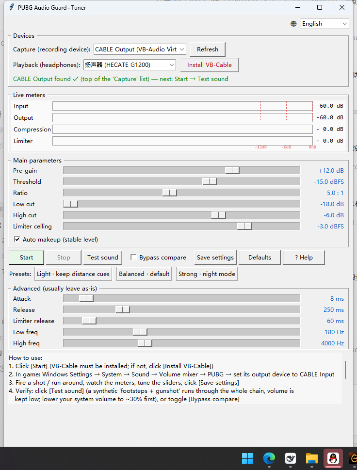

# PUBG Audio Guard

**Ночная защита слуха для PUBG** — аудиопроцессор, который обрабатывает только звук PUBG: приглушает пики выстрелов, взрывов и «бубнение» гранат, поднимает шаги — снижайте общую громкость и всё ещё слышите всё. Остальные программы (голосовой чат, уведомления) не затронуты.

[English](README.md) | [简体中文](README_zh-CN.md) | `Русский` | [Español](README_es-ES.md) | [日本語](README_ja-JP.md)



## Как это работает

```
PUBG ──> виртуальный кабель (CABLE Input) ──> программа (захват → предусиление → EQ → компрессор → лимитер) ──> наушники
остальные программы ──────────────────────────────────────────────────────────────────────┘ напрямую, без обработки
```

Виртуальный кабель (VB-Cable, бесплатный) — «перевалочный пункт»: PUBG играет в него, программа забирает звук, обрабатывает и выводит в наушники. Лимитер держит все пики под фиксированным потолком; EQ срезает низкочастотный «удар в грудь» у гранат и высокий «звон в ушах» после взрывов. Дополнительная задержка ~70 мс — незаметна.

## Установка

1. **VB-Cable**: скачайте с [vb-audio.com/Cable](https://vb-audio.com/Cable/), правый клик по `VBCABLE_Setup_x64.exe` → *запуск от администратора* → **перезагрузка**.
2. **Python-пакеты**: `python -m pip install numpy sounddevice scipy`
3. **Запуск**: `python pubg_audio_gui.py` (или `start_gui.bat`)

## Направить звук PUBG в процессор

Когда игра запущена и звучит: `Alt+Tab` → правый клик по значку динамика → **Открыть микшер громкости** → найдите PUBG → устройство вывода = **CABLE Input (VB-Audio Virtual Cable)**. Windows запомнит настройку; остальные программы продолжат использовать вывод по умолчанию.

> Нет звука в игре? Сначала нажмите [Пуск] в программе — PUBG, направленный в кабель, молчит без обработчика.

## Использование GUI

- **Пуск / Стоп** — обработка вкл/выкл
- **Тест звука** — синтетические «шаги + выстрел» через всю цепочку (без запуска игры)
- **Сравнение (байпас)** — мгновенное переключение обработано/оригинал
- **Пресеты** — лёгкий / сбалансированный / сильный (ночной режим)
- **Индикаторы** — уровни и текущая работа компрессора/лимитера в дБ
- **Наведите на ползунок** — подробное описание с советами
- **Язык** — выпадающий список справа сверху
- **Сохранить** — записывает `config.json`

## Параметры

| Параметр | Умолчание | Действие | Настройка |
|---|---|---|---|
| Предусиление | +3 дБ | поднимает тихие звуки | шумно/глухо → минус 1–2 дБ |
| Порог | -18 дБFS | линия начала сжатия | выстрелы пугают → ниже; дистанция страдает → выше |
| Соотношение | 2.5:1 | сила сжатия | больше = «ночь», хуже дистанция |
| Срез низа | -8 дБ | убирает «бубнение» гранат | ещё бубнит → -12 |
| Срез верха | -4 дБ | глушит «звон» и резкость | ещё режет → -8 |
| Потолок | -3 дБFS | жёсткий предел пиков | держать; полный индикатор = усилить компрессию |

## Вопросы

- **После установки VB-Cable пропал системный звук** — установщик делает кабель устройством по умолчанию. Запустите `set_audio_default.ps1` или верните наушники/микрофон по умолчанию вручную. GUI предупреждает об этом.
- **Трещотки** — увеличьте буфер: `python pubg_audio.py --target 6 --blocksize 960`.
- **Это чит? Бан?** — нет. Программа читает только системный аудиопоток и играет обработанную копию; процесс игры, память и сеть не затрагиваются. PUBG и KRAFTON — товарные знаки их владельцев; проект неофициальный.

## Языки

Переводы — в [`i18n.py`](i18n.py): добавьте `STRINGS["xx_XX"]` (76 ключей, отсутствующие откатываются к английскому) и зарегистрируйте в `SUPPORTED`.

## Лицензия

[MIT](LICENSE)
